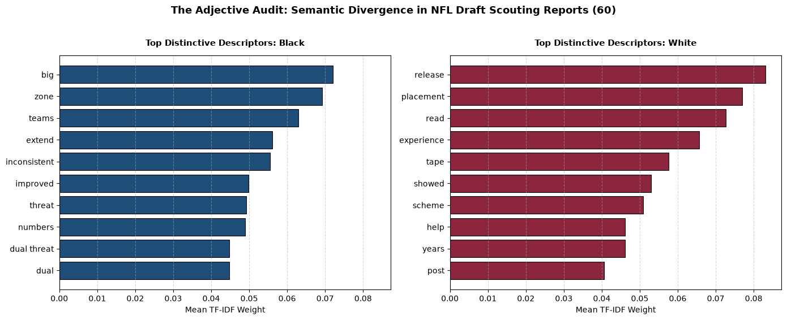
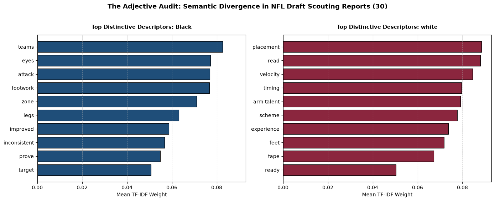

# NFL Adjective Audit

A small text-analysis project that asks: **do NFL draft scouting reports describe Black and white quarterbacks with different language?**

It takes pre-draft scouting reports for QBs (overview, strengths, weaknesses), splits them by demographic group, and uses TF-IDF to surface the words and two-word phrases that most separate the two cohorts.

## Contents

| File | Description |
| --- | --- |
| `data/scouting_corpus_30.csv` | *(private, not in this repo)* Pilot corpus: 30 QBs (15 Black, 15 white), draft years 2017–2026 |
| `data/scouting_corpus_60.csv` | *(private, not in this repo)* Expanded corpus: 60 QBs (30 Black, 30 White), draft years 2015–2026 |
| `eda_30.ipynb` | Analysis notebook for the 30-player corpus |
| `eda_60.ipynb` | Analysis notebook for the 60-player corpus (same pipeline) |
| `figures/` | Charts exported from the notebooks |

### Data schema

The scouting-report text isn't published here. To rerun the notebooks, put your own CSVs with this schema in `data/`.


Both CSVs share the same six columns:

| Column | Description |
| --- | --- |
| `player_name` | Quarterback's name |
| `draft_year` | Year of the draft class |
| `demographic_group` | Cohort label (`Black` / `White`) |
| `overview` | Free-text summary from the scouting report |
| `strengths` | Free-text strengths section |
| `weaknesses` | Free-text weaknesses section |

> Note: the 30-player CSV uses lowercase `white`, while the 60-player CSV uses `White`. The notebooks read the group names straight from the data, so this only affects chart titles. Normalize the casing if you merge the two files.

## Method

Each notebook runs the same three steps:

1. **Load and combine.** Reads the CSV, fills empty text fields, and joins `overview + strengths + weaknesses` into one `evaluation_text` column per player.
2. **TF-IDF and divergence.**
   - Tokenizes unigrams and bigrams (`ngram_range=(1, 2)`), alphabetic tokens of 3+ letters only.
   - Removes standard English stopwords plus a custom list of football and metadata noise (`quarterback`, `throw`, `ball`, `college`, `round`, and so on), so the results show descriptive language and not position vocabulary.
   - Keeps terms that appear in at least 2 documents (`min_df=2`), capped at the top 150 features.
   - Averages TF-IDF weights within each cohort, and defines **divergence** as the difference between the two cohort means.
3. **Visualize.** Plots side-by-side horizontal bar charts of the 10 most divergent terms for each cohort.

## Results

Top 10 most divergent terms per cohort, by mean TF-IDF weight.

**60-player corpus**



**30-player pilot corpus**



Across both corpora, Black QBs' reports lean toward physical and developmental language (`big`, `extend`, `dual threat`, `legs`, `inconsistent`, `improved`, `prove`). White QBs' reports lean toward processing and technique language (`placement`, `read`, `release`, `timing`, `scheme`, `experience`). `inconsistent`, `improved`, `zone`, and `teams` appear on the Black side in both runs; `placement`, `read`, `scheme`, `experience`, and `tape` appear on the white side in both. See [Caveats](#caveats) before drawing conclusions.

## Getting started

Requirements: Python 3 with `pandas`, `numpy`, `matplotlib`, `scikit-learn`, and Jupyter.

```bash
python3 -m venv .venv
source .venv/bin/activate
pip install pandas numpy matplotlib scikit-learn jupyter ipykernel
python -m ipykernel install --user --name nfl-adj-audit   # kernel name the notebooks expect
jupyter notebook eda_60.ipynb
```

Run all cells. The notebook loads its CSV from `data/` with a relative path, so start Jupyter from this directory.

## Tuning the analysis

These settings are in the Step 2 cell:

- **`custom_noise` / `metadata_noise`**: add domain words that show up in the top terms without saying anything about how a player is described.
- **`max_features`**: increase it to consider rarer terms. Lower it to focus on common vocabulary.
- **`min_df`**: raise it to drop terms used for only a few players.
- **`.head(10)`** in Step 3: change how many terms are plotted per cohort.

## Caveats

- **Small sample.** With 30–60 reports, a single player's report can move the results a lot. Treat the output as exploratory, not as statistical evidence.
- **No significance testing.** Divergence is a raw difference in means. A permutation test (shuffling the group labels) would show which gaps are larger than chance.
- **Confounders.** Play style (for example, running vs. pocket QBs), draft position, and era all affect the vocabulary and may correlate with cohort.
- **Single source style.** If the reports come from one outlet or analyst, the results describe that writer's vocabulary, not scouting language in general.
